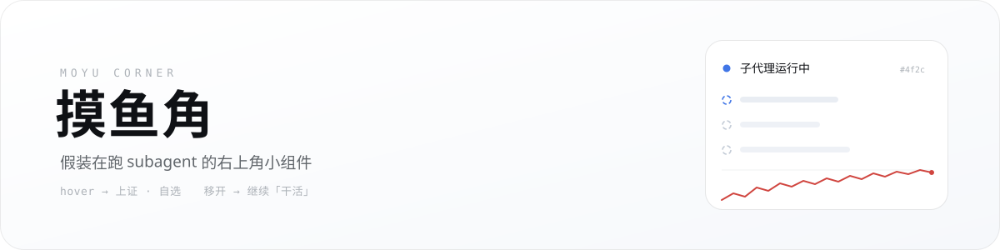
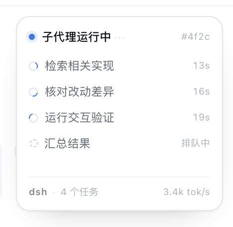
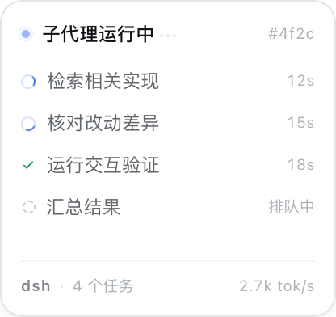
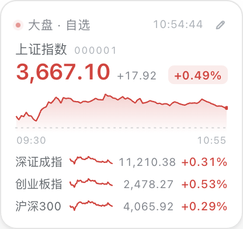
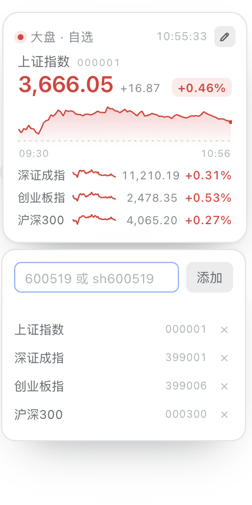
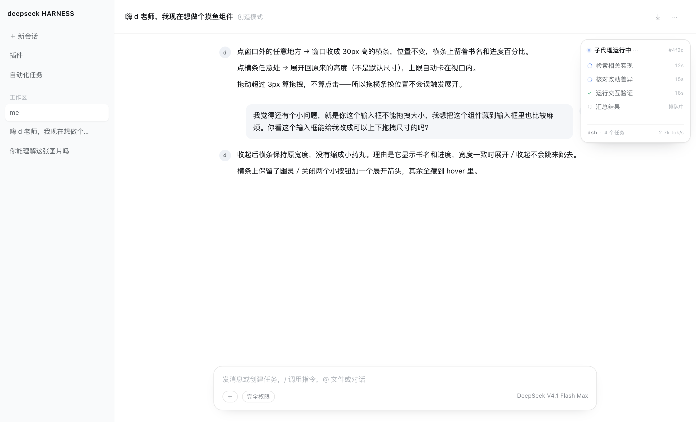
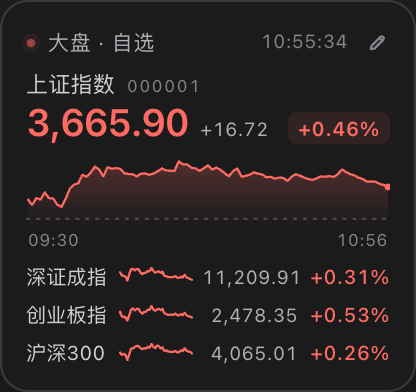

<div align="center">
  
</div>

<div align="center">

**一个假装在跑 subagent、其实在看大盘的右上角小组件。**

给 [DeepSeek Harness](https://github.com/deepseek-ai/deepseek-harness) Web 端做的非官方插件。

[](#)
[](https://www.npmjs.com/package/dsh-moyu-widget)
[](LICENSE)
[](#)
[](#)



</div>

## 老板来了，老板走了

默认它长这样——对话右上角一个安分的小卡片：「子代理运行中」，状态点在呼吸，三行任务在转，右下角还有像模像样的 `2.7k tok/s`。

**老板路过。** 嗯，在干活。

**老板走了。** 鼠标移上去，同一块地方翻成上证指数 + 自选股：分时线、涨跌幅、红绿一个不少。

**老板又来了。** 鼠标一移开，它立刻变回「子代理运行中」。

> 本组件不产生任何真实 subagent。请放心摸鱼。

## 两张脸

| 静息 · 像在干活 | 悬停 · 像在盯盘 |
| :---: | :---: |
|  |  |

点右上角的小铅笔可以编辑自选（最多 4 个，存 localStorage），支持 `600519`、`sh600519`、`1.600519` 三种写法：



放在真实对话页面里大概是这样，基本只剩一圈很细的边和一点点浮起来的影子：



暗色模式不强行刷白，跟着页面走：



## 它尽量不打扰你

- **只在有对话的页面出现。** 新会话页（hero 页）、设置页、插件页都没有它。
- **静息态一个请求都不发。** 只有鼠标悬停时才拉行情，移开就停；离开这个页面就没人记得它。
- **默认就是“在工作”。** 没有弹窗、没有声音、没有小红点，鼠标不碰它就不会暴露。
- **窄了会自己藏起来。** 对话区小于 880px（比如右侧面板展开）时自动隐藏，不压正文。
- **涨红跌绿。** A 股习惯，没跟着欧美股市反过来。

## 装到 DSH 里

前提：你用的是带 Web 端的 DeepSeek Harness（桌面版或 `dsh web`），并且能访问东方财富 / 腾讯的行情接口。

**从 npm 装（推荐）**

在 DSH 的会话里让 agent 执行：

```
plugin_manager → install_bundle → dsh-moyu-widget
```

装完刷新一下页面，右上角就有了。也可以手动：

```bash
cd ~/.dsh/profiles/<你的 profile>
pnpm add dsh-moyu-widget
```

然后把 `dsh-moyu-widget` 加进同一个 `package.json` 的 `dsh.profile.bundles` 数组，重开窗口。

**从源码装（改代码用）**

```bash
git clone https://github.com/tianluyao328/moyu-widget.git
```

```
plugin_manager → install_bundle → link:/绝对路径/moyu-widget
```

> 插件 id 是 `dsh-moyu-widget`，bundle 里自带一行 `cordis.patch.yml`，不需要额外改 profile 的 patch。

## 它是怎么工作的

- **挂载点**：注册进 `conversation.session.header.utilities`，所以天然只存在于「有会话」的页面。
- **定位**：在 header 里放一个不可见的锚点，向上找到 `<header>`，用 `getBoundingClientRect()` 算出位置，再 `createPortal` 到 `document.body`，`position: fixed` 贴住对话区右上角。侧栏、右侧面板变化用 `ResizeObserver` 跟随。
- **新会话判定**：读对话根节点的 `data-phase`，`hero` 就藏起来，`MutationObserver` 盯着它翻面。
- **行情**：东方财富 `push2.eastmoney.com` 的 JSON 报价；偶发空响应时自动回退到腾讯 `qt.gtimg.cn`（GBK，`TextDecoder('gbk')`）。
- **分时**：腾讯 `web.ifzq.gtimg.cn` 的分钟线；主图和每行迷你线都按「相对昨收」分段染红/绿，昨收用虚线标出。
- **配色**：全部走 DSH 的 `--dsw-alias-*` token，暗色由 `body[data-ds-dark-theme]` 覆盖；没有 token 时有浅色兜底。

## 想改点什么

| 想改 | 去哪 |
| --- | --- |
| 假任务文案 | `client.js` 里的 `DICT.zh.tasks`（用竖线分隔） |
| 默认自选 | `DEFAULT_LIST` |
| 卡片大小 / 圆角 | `.mw-root` 的 `width` / `height` / `border-radius` |
| 红绿 | `--mw-up` / `--mw-down` |
| 窄屏隐藏阈值 | `frame.width < 880` |
| 行情刷新频率 | `REFRESH_MS`（默认 20s）与 `TREND_MS`（默认 60s） |

## 已知的坑

- 行情来自公开的第三方接口，**不保证稳定、不保证实时、不构成任何投资建议**。接口挂了会显示「行情暂不可用 · 重试」。
- 只在 DSH 的 Web / 桌面端有效；CLI 里没有界面可挂。
- 不是官方插件，DSH 升级后 slot 或客户端 API 有可能变，坏了欢迎提 issue。
- 自选最多 4 个，多了放不下——这是设计，不是 bug。

## License

[MIT](LICENSE) © tianluyao328

<div align="center">

如果它帮你多摸了一会儿鱼，点个 ⭐ 不过分吧。

</div>
